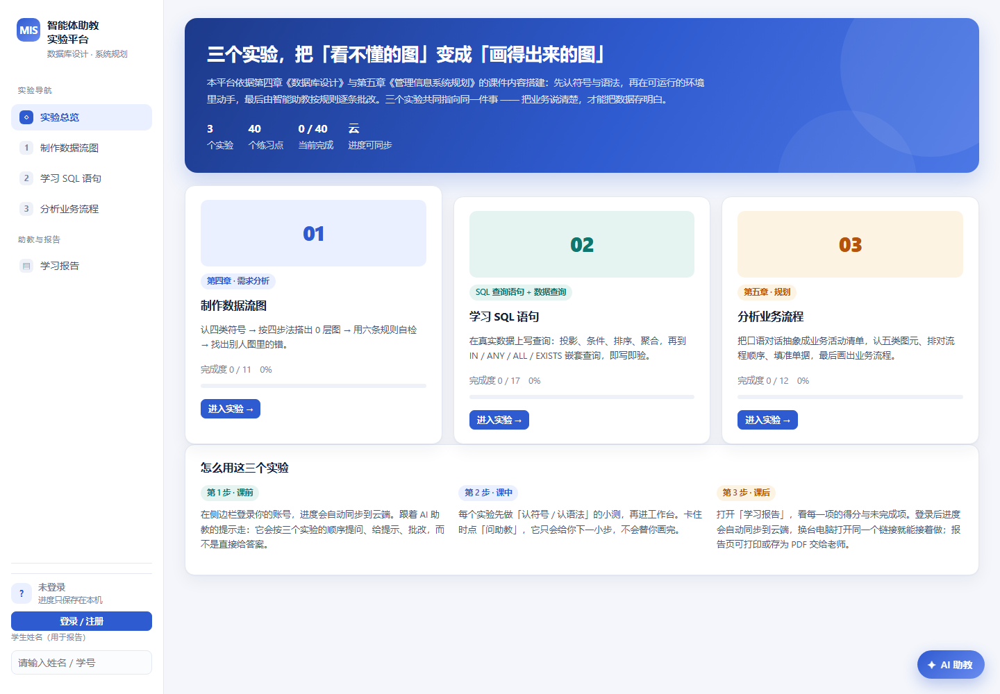

# MIS 实验工坊 · 管理信息系统 AI 助教实验平台

> 《管理信息系统》课程的配套实验平台：把「数据库设计」「系统规划」「SQL 查询」三章做成 40 个可自动判分的练习点，并接入一个能诊断、会记账、可做学情分析的 AI 助教。



## 这是什么

课堂里常见的困境是：**老师讲得清，学生练不着**。数据流图要动笔画、SQL 要真跑一遍才知道错在哪，而课件只能看。

这个平台把三章内容变成可动手的实验：

| 实验 | 内容 | 判分方式 |
|---|---|---|
| 一 · 制作数据流图 | 40 个练习点中的 11 个：符号认知、拖拽画 0 层 DFD、找错 | 六条规则自动自检（要素 40 / 进出 20 / 存储 15 / 直连 10 / 命名 15） |
| 二 · 学习 SQL 语句 | 17 道题，从 `SELECT *` 到 `EXISTS` 相关子查询 | **真实执行**：内置迷你 SQL 引擎，结果集比对判分，等价写法都算对 |
| 三 · 分析业务流程 | 12 个练习点：五类图元配对、口语抽象排序、单据填空、自己画一张 | 符号语义 + 步骤顺序 + 同义词匹配 |

合计 **40 个练习点**，全部在前端完成，不依赖后端。

## 亮点

- **自研迷你 SQL 引擎**（`assets/sql-engine.js`，约 600 行）：支持 `SELECT / WHERE / BETWEEN / LIKE / 聚合 / GROUP BY / HAVING / 排序`、四类嵌套查询（`IN`、比较符、`ANY·ALL`、`EXISTS`）以及增删改。学生写的语句真的跑在数据上，报错会翻译成可读的错因。
- **画图工作台**：五类图元拖拽、连线、命名，自检按规则逐项打分并给出具体诊断，而不是只给一个分数。
- **AI 助教闭环**：学生在哪道题上卡住，助教知道上下文（题目、他的 SQL、判分反馈），判完写进「错题登记表」；教师说【教师模式】就能拿到班级共性错因、错题 Top 5 和补讲建议。
- **离线可用**：三个实验、判分、画图全部在浏览器本地运行，打开就能做，无需注册登录。

## 在线体验

- **练习入口（学生用这个）**：https://caril633.github.io/web-madebylrr/
  三个实验、判分、画图全在里面，打开就能做，进度自动保存在本机浏览器。智能体助教向学生推荐的就是这个链接。
- **云端账号版（可选）**：https://mis-lab-assistant.app.workbuddy.host/
  内容与练习入口完全一致；需要**登录后云端同步进度**（换设备接着做）时用这个版本。

> 若链接不可用，可直接下载本仓库，双击 `index.html` 运行（全部实验功能可用）。

## 本地运行

无需构建、无需依赖：

```bash
# 方式一：直接双击 index.html
# 方式二：起一个静态服务器（推荐，避免个别浏览器的 file:// 限制）
python -m http.server 8000
# 然后访问 http://127.0.0.1:8000/
```

## 目录结构

```
.
├── index.html                 入口页
├── assets/
│   ├── style.css              全部样式
│   ├── data.js                数据集（Customers 91 / Products 77 / Orders 182 等）
│   ├── sql-engine.js          迷你 SQL 引擎（词法 → 语法 → 执行）
│   ├── lab-dfd.js             实验一：数据流图工作台
│   ├── lab-sql.js             实验二：SQL 实验室（17 题 + 判分）
│   ├── lab-bpm.js             实验三：业务流程（图元 / 排序 / 填空）
│   ├── lab-bpm-draw.js        实验三：自绘业务流程图
│   ├── app.js                 外壳：导航、进度、报告
│   ├── cloud.js               云服务接入：登录、进度同步
│   └── vendor/                云服务 SDK（本地打包，不依赖 CDN）
├── 智能体/
│   ├── 01-系统提示词-v2.md     助教系统提示词（四入口、五步工作流、说话方式、边界）
│   ├── 02-知识库-v3.json       50 个知识实体 + 40 题映射 + 22 类错因
│   ├── 03-系统方案.md          系统设计说明
│   ├── 04-错题登记表-字段清单.md
│   └── 测试数据/               30 名学生的模拟错题数据（用于教师端演示）
├── 实验指导书.md               教师用：学时、步骤、评分量规
└── 学生使用说明.md             可直接发班级群
```

## 技术栈

- 原生 HTML / CSS / JavaScript，无框架、无构建步骤，双击即用
- 自研 SQL 解析与执行引擎（不依赖 sql.js 等外部库）
- 云端账号版额外接入云服务（PostgreSQL + RLS、手机验证码 / 微信登录）

## 关于 AI 助教

助教不是"套壳聊天"，它有三层能力：

1. **知识库**：50 个实体（第五章 10 / 第四章 22 / SQL 17），每个含定义、要点、口诀或示例、常见误解；40 道题逐题挂到实体与错因码上。
2. **上下文**：学生在哪个实验、哪道题、写了什么、判分反馈是什么，都会一起带给模型。
3. **学情数据**：核对完的错题写进数据表（学号 / 题号 / 错因码 / 时间），教师模式下按班级聚合。

## 说明

本项目为教学用途的课程配套工具。智能体部分依托大赛指定平台开发（模型、OCR、知识库、数据表均使用平台资源）；本仓库中的网页为**纯前端**教学配套工具，不含后端计算，也不调用任何大模型接口，可完全离线运行。

题库与数据均为教学自建；`智能体/测试数据/` 中的学生信息为模拟数据，不对应真实个人。
